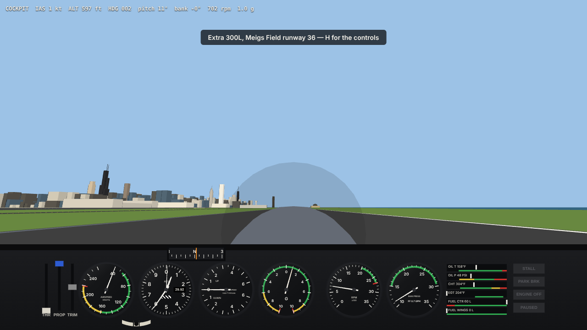

# Extra 300L at Meigs Field

A flight simulation of the Extra 300L aerobatic airplane that runs inside an
[Arrival.Space](https://arrival.space) space, as a vibe (an `ArrivalScript`
plugin). It starts where Microsoft Flight Simulator always started: runway 36
at Chicago's Meigs Field (CGX), closed in 2003 and reopened here.

Place the vibe where the airplane should park. Meigs Field, the lake and
Chicago are laid out around it. Walk up to the airplane and press **E** (or
tap it) to fly. Press **H** in the cockpit for the controls.



## What is modelled

- **Flight dynamics**: one rigid body with a spinning propeller, stepped at a fixed 480 Hz.
  - **Aerodynamics** come from a component build-up. Each wing and tail strip sees its own airflow, over the full ±180° range. Damping, stall, spins, knife-edge and inverted flight follow from the geometry rather than from tables.
  - **Propeller**: a constant-speed MT 3-blade with a flyweight governor, modelled with blade elements and momentum theory. It produces the slipstream and swirl over the tail, P-factor, and the engine's torque reaction.
  - **Engine**: a Lycoming AEIO-540 whose manifold pressure comes from throttle airflow balanced against cylinder demand. It has a starter, mixture cut-off, fuel burn, and oil and cylinder-head temperatures.
- **Landing gear**: spring-damper struts with slip-angle tyres, differential brakes and a tailwheel steered by the rudder. Prop tip, wingtips and rudder are hard points, so prop strikes and ground loops happen.
- **Gauges** carry their real instrument errors and lags:
  - **Airspeed**: drops out at high angle of attack.
  - **Altimeter**: three-pointer with a Kollsman window.
  - **VSI**: the classic 6-second lag from the capsule's calibrated leak.
  - **G-meter**: max/min tell-tales.
  - **Whiskey compass**: pendulous card, with turning and acceleration errors from Chicago's 70° dip.
  - **Engine**: slip ball, tachometer, manifold pressure, fuel flow, and the engine monitor stack.
- **Chicago from OpenStreetMap**: about 15,000 building footprints, extruded at load time into procedural geometry.
  - **Facades:** procedural window patterns sized to real floors and bays.
  - **Roofs:** flat roofs with courtyards; gabled houses; pyramids and domes where OSM tags them.
  - **Tall towers:** built from their OSM `building:part`s, so Sears keeps its setbacks and antennas.
  - **Heights:** from OSM, or from the City of Chicago's storey counts.
  - **Years:** a building's year comes from the City's `year_built`. The default skyline is 2002, the last full year of Meigs; the *Skyline year* setting shows any other year.
  - **Ground:** the Lake Michigan shore, the river, parks, the main roads and the rail lines. The gear knows land from water.
  - **Collisions:** hitting a building ends the flight.
- **Meigs Field**:
  - The 3,948 ft runway on Northerly Island, painted as it was.
  - The terminal and tower, Burnham Harbor, Navy Pier.
  - The Loop skyline as it stood in the 1990s: Sears, Aon, Hancock, Two Prudential, 311 S Wacker, Lake Point Tower.
  - Lake Michigan at its real level, 15 ft below the field.

The published numbers it is tested against:

| | model | Extra 300L |
|---|---|---|
| max level speed at 1,000 ft | 189 KTAS | ~185 kt |
| climb, full power, 795 kg | 2,730 fpm @ 85 KCAS | 3,200 fpm |
| stall, power off, 950 kg | 59.5 KCAS | 55 KIAS |
| roll rate, full aileron, 160 KCAS | 437 °/s | ~400 °/s |
| idle / full static rpm | 700 / 2,620 | 700 / ~2,650 |
| takeoff, lift-off | ~130 m, 65 kt | — |

## Working on it

```bash
cd extra300
npm install
npm test               # 68 unit, component and flight-test checks (~4 s)
npm run build          # → dist/extra300-meigs.mjs, the single-file vibe
npm run serve          # http://localhost:8740/tests/harness/  (PlayCanvas + an Arrival stand-in)
npm run test:e2e       # headless Chromium on the local stand-in: boards, rolls, screenshots into dist/shots/
npm run test:arrival   # the real arrival.space client, as a guest, read-only: loads the vibe, boards, flies, exits
npm run osm:fetch      # download OSM + City of Chicago data (data/osm/raw/, not committed)
npm run osm:bake       # → src/world/data/chicagoOsm.js, the compact city the vibe ships with
```

`test:arrival` opens a public space in headless Chromium and blocks every
request that would write anything. It injects the built vibe and checks that
it boards, flies and hands the camera back. The last run was on client 1.26.0
(`worldScale` 0.7) and passed with no errors from the vibe.

`?fly=1&view=chase` on the harness URL boards right away; `?bundle=0` loads the sources without building.

## Syncing with the space

`scripts/sync.mjs` drives the official `arrival` CLI
([arrival-plugins/tools/arrival-cli](https://github.com/arrival-space/arrival-plugins/tree/main/tools/arrival-cli)):

```bash
npm run sync -- setup        # install the CLI into .arrival-cli/
npm run sync -- login        # browser sign-in; or export ARRIVAL_TOKEN=<Arrival API key>
npm run sync -- create       # make the space, its id goes into arrival.json
npm run sync -- validate     # pull, stage our files, server-side dry-run
npm run sync -- push         # test, build, pull, stage, validate, push
```

Every push pulls the space first and then writes only the files this repo owns:

- the plugin
- its host entity
- the runway-36 spawn point
- a few `room.json` keys

Anything edited in the browser stays as it is.

## Layout

```
src/sim/          flight model: atmosphere, aero, engine, propeller, gear, rigid body (no PlayCanvas)
src/sim/aircraft/ the airplane as data, every number tagged [pub] / [est] / [tune]
src/instruments/  gauge physics and the canvas instrument panel
src/world/        WGS-84 local frame, Meigs Field, the OSM codec and the baked city
src/render/       engine-free geometry: the Extra, Meigs, procedural buildings, sky, camera maths, sound
src/input/        keyboard / gamepad / touch / mouse-yoke → controls
src/plugin/       the Arrival.Space glue (the only code that touches pc / ArrivalSpace)
tests/            node --test suites, the flight-test autopilot, the browser harness
scripts/          build, serve, sync
docs/PLAN.md      architecture, conventions, validation, roadmap
```

## Data

Map data © [OpenStreetMap](https://www.openstreetmap.org/copyright) contributors, available under the
Open Database License. Building years and storey counts come from the
[City of Chicago data portal](https://data.cityofchicago.org/) (Building Footprints).
